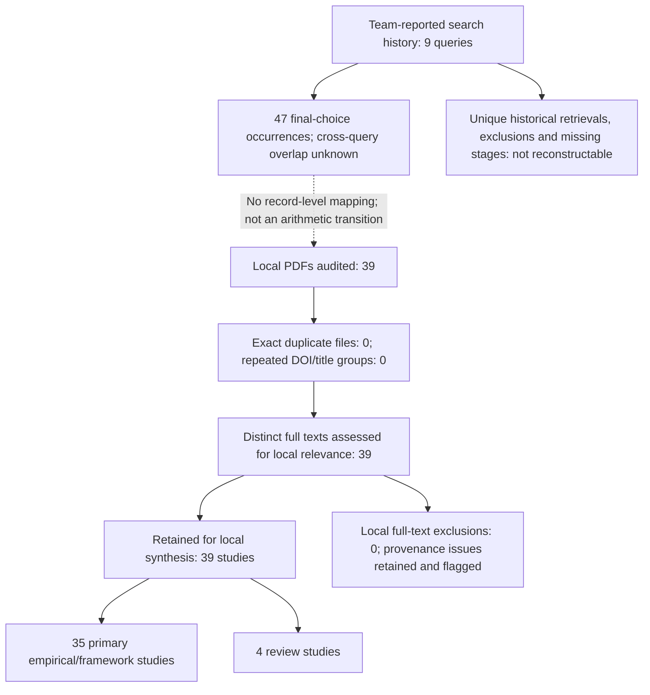

# II. REVIEW PROTOCOL AND METHODOLOGY

This structured literature review examines the evidence supporting GridMind's five capabilities: missing-telemetry reconstruction, demand and renewable forecasting, event diagnosis, cascade-risk prediction, and corrective-action recommendation. Project-wide studies provide an additional integration perspective. Evidence is synthesized against the five research questions stated in Section I: existing research, methods, tools, gaps, and proposed directions. This section retrospectively documents the team's reported search and selection procedure and a subsequent audit of the supplied PDFs. It does not claim a prospectively registered protocol or an independently reproducible systematic database search.

The documentary audit was performed on 5 November 2026 and was restricted to PDFs inside `research papers/` and its subfolders. No supplementary searches or outside studies were added. The team-provided history is preserved in [search_history.csv](reports/literature_review/search_history.csv); file identities, evidence locations, study classifications, assessment status, and unresolved records are recorded in [study_ledger.csv](reports/literature_review/study_ledger.csv). Historical search counts and newly verified local-file counts are different evidence sources and are reported separately.

## A. Eligibility Criteria

The reported searches targeted power-system research relevant to at least one GridMind function or to integrated decision support. Publication-type filters included research articles, articles, and, in some queries, conference papers. Most specified year filters were 2021–2026; the reconstruction and corrective-action rows specified 2021–2027. The 2027 upper bound is preserved as a historical filter setting, not evidence that future publications were reviewed. The forecasting and measurement-anomaly rows supplied filtered counts without a publication-year range. Subject and discipline restrictions differed by query; no uniform filter is retrospectively imposed. The team also reported open-access filtering, but full-text availability in the current collection does not independently establish each source's license.

For the local audit, a study is retained for extraction when its PDF provides assessable research on a GridMind task, a relevant benchmark or evaluation method, or project-wide integration. Review articles are classified separately from primary empirical studies. Task-adjacent work, such as distribution-state estimation, is retained with its boundary stated rather than treated as a direct reproduction target. Older or otherwise unmatched sources remain visible as eligibility exceptions or unresolved historical mappings. Language is recorded from the English-language text available in the PDFs; an original language filter is not documented.

Exact duplicate files and repeated versions of the same study are mapped to one study identity, preserving all source paths. A file is not discarded because its filename is generic or because a complete historical retrieval trail is unavailable. Preprints are identified from the supplied version; their presence is not used to invent a historical preprint-eligibility rule. Sources cited only in other papers' bibliographies are not added to the study set. No quality-score exclusion threshold is retrospectively applied.

## B. Search Strategy

The team supplied nine search rows. The expressions below preserve their reported wording after removing personal initials and source labels as requested. In particular, Q07's Boolean expression has not been silently parenthesized. Database names and execution dates are not consistently recorded in this account, so the original searches cannot be reproduced exactly from these records alone. The audit date is not presented as the original search date.

| Search ID / track | Expression as reported |
|---|---|
| Q01 / cascade risk | `Cascading failure prediction in power systems using machine learning` |
| Q02 / reconstruction | `("power system" OR "power grid") AND ("missing measurements" OR "measurement reconstruction" OR "data imputation")` |
| Q03 / diagnosis | `Power system event classification and fault localization using machine learning` |
| Q04 / cascade risk | `"cascading failures" AND "transmission lines"` |
| Q05 / forecasting | `(wind AND (solar OR photovoltaic) AND (load OR demand)) AND ("net load" OR "short-term forecasting")` |
| Q06 / integration | `"smart grid" AND "decision support system" AND "artificial intelligence"` |
| Q07 / corrective action | `Power System OR Power Grid AND Corrective Action OR Corrective Control AND Artificial Intelligence` |
| Q08 / integration | `"power grid" AND "digital twin" AND "decision making"` |
| Q09 / diagnosis | `"synchrophasor" AND ("bad data" OR "measurement anomalies" OR "clock errors") AND ("grid events" OR "disturbance")` |

| Search | Initial | After date | After type | After subject | After discipline | After open-access filter | Final search count | Reported title/abstract stage | Final choices |
|---|---:|---:|---:|---:|---:|---:|---:|---:|---:|
| Q01 | 1815 | 907 | 780 | No filter | No filter | 363 | 363 | 20 | 3 |
| Q02 | 1156 | 950 | 752 | 596 | 492 | 204 | 204 | 53 | 8 |
| Q03 | 2004 | 1493 | 1013 | 210 | No filter | 153 | 153 | 49 | 12 |
| Q04 | 556 | 300 | 159 | No filter | No filter | 83 | 83 | 10 | 2 |
| Q05 | 2181 | 1535 | 1236 | 1236; no subject filter | 791 | 163 | 163 | 54 | 7 |
| Q06 | 893 | 886 | 400 | No filter | No filter | 171 | 171 | 10 | 3 |
| Q07 | 7901 | 7594 | 4307 | Not recorded | Not recorded | 2068 | 577 | 11 | 6 |
| Q08 | 1899 | 1856 | 861 | No filter | No filter | 385 | 385 | 25 | 2 |
| Q09 | 114 | 86 | 55 | No filter | No filter | 34 | 34 | 34 | 4 |

Q01 uses the team's corrected order, 907 after date filtering and 780 after type filtering. Q02's final shortlist is **8**, superseding the earlier 14→7 and 7 entries. Q07's final choice count is **6**. Its reduction from 2068 after open-access filtering to 577 final search records has no documented intervening operation. The title/abstract-stage column is retained as supplied; it is not assumed to identify all records screened or all records retained. Detailed filter labels and missing fields are preserved in the search-history CSV.

## C. Study Selection Process

The team reports using title/abstract screening followed by final paper selection. The supplied records do not contain individual historical exclusion decisions or a complete mapping from searches to filenames. The present audit therefore inventories the delivered collection, extracts bibliographic identities, compares DOI/title/version and file hashes for duplication, and records relevance from the full texts. It is a documentary review, not evidence of independent dual human screening or supervisor adjudication.

The nine historical final-choice values sum to **47 selection occurrences**. This is not a deduplicated study total: Q01/Q04 and Q03/Q09 can overlap, and query-level choices are not linked to individual delivered papers. The current folders contain **39 PDFs**: cascade risk 3, corrective action 6, diagnosis 10, forecasting 7, reconstruction 8, and Whole Project 5. Agreement between an individual folder count and a query count does not establish a paper-by-paper match. The historical diagnosis rows report 12 and 4 choices, while the diagnosis folder contains 10 files; the historical cascade rows report 3 and 2 choices, while that folder contains 3 files. Missing papers, overlap, and reassignment cannot be distinguished from counts alone.

The local identity audit found **39 distinct study records**, with **0 exact duplicate files** and **0 repeated primary-DOI/title study groups**. All 39 are retained for qualitative synthesis: 35 primary empirical/framework studies and 4 review studies. No local full-text exclusion was imposed. This is an audit disposition, not a reconstruction of the original screening decisions. The eight missing-telemetry PDFs are eight distinct studies. S25 has unresolved manuscript provenance/year, and S37 has an unresolved publication year in its in-press PDF; both remain visible rather than being silently dropped. No verified printed publication year falls outside 2021–2026, although that does not independently prove compliance with every original query filter.

The following PRISMA-style account separates reported search history from the auditable local collection. It is not a completed PRISMA 2020 database-search flow: unique retrieved records, historical exclusions, and query-to-file transitions remain unavailable.

## D. Quality Assessment

The university guide's five criteria are used for documentary appraisal. Each receives **Yes=1, Partial=0.5, No=0** only when the supporting text can be assessed; unavailable evidence is marked **not assessed**, not automatically scored zero. A mean is reported only for a complete five-item assessment. No score is used to infer that the team historically excluded a paper.

| Criterion | Documentary question | Evidence expected |
|---|---|---|
| Objective clarity | Is the task or review objective explicit? | Abstract/introduction and defined target. |
| Method suitability | Is the proposed method explained and matched to the task? | Method description; for reviews, a search/synthesis approach. |
| Evaluation transparency | Are the data/evidence, experimental conditions, baselines, and metrics reported sufficiently to interpret results? | Experiment/protocol tables; for reviews, source selection and synthesis procedure. |
| Reproducibility | Is enough information or accessible material provided to reconstruct the procedure? | Data/code availability, preprocessing, model settings, and splits; availability on request or confidential data qualifies the assessment. |
| Valid conclusions | Are the conclusions bounded by the reported evaluation and limitations? | Results, discussion, and explicit limits on transfer/deployment claims. |

Appraisal performed for this draft is labeled **provisional documentary assessment** in the ledger and is not represented as independent expert validation. Evidence passages and unresolved issues accompany the scores. Review papers and empirical papers are assessed against their own tasks; a review is not penalized for lacking model-training splits. Team confirmation of the assessments remains outstanding. No aggregate quality ranking across incompatible tasks is used to select GridMind's models.

## E. Data Extraction and Synthesis

The extraction unit is the unique research study, while the inventory unit is the supplied PDF. The ledger preserves both identities, source paths, hashes, title, authors, year, venue, DOI/preprint identifier, publication-version status, study type, method family, capability tags, RQ relevance, and historical-mapping status. It also records task, readings/features consumed and predicted, dataset/network, horizon or observation window where available, split/baselines/metrics, bounded findings, limitations, and PDF page locations.

Method-specific evidence is extracted rather than forced into one metric. Reconstruction records distinguish observed versus recovered channels, missingness patterns, future-reading requirements, equipment status, topology assumptions, and downstream tests. Forecasting records distinguish targets, horizons, chronological availability, weather/capacity features, and persistence baselines. Diagnosis records distinguish event type, physical location, measurement error, and episode-level evaluation. Cascade records distinguish initiating-outage assumptions, propagation/consequence targets, and simulator conditions. Corrective-action records distinguish the action space, candidate validation, and simulated operational outcomes from classification accuracy.

Synthesis first compares studies within a capability, then uses their shared patterns and differences to answer RQ1–RQ5. Numerical findings retain their units and experimental context; errors from different datasets are not pooled or ranked as if they came from a common benchmark. Missing details are labeled unreported or unverified. Paper-reported findings, our cross-paper interpretation, and GridMind's proposed adaptation remain distinguishable. Cross-cutting papers inform architecture and decision support without being counted as five separate studies.

## F. Data Extraction Table — Table I

Table I summarizes every unique study retained in the local corpus. Study IDs link directly to the ledger, which contains the full citation identity and supporting pages. These are local extraction IDs, not replacements for Section I's existing citation numbers. Publication status is recorded from the supplied PDF only; the present audit does not search for later published versions.

| Study / citation identity | Task, readings and method | Data and evaluation | Bounded finding, limitation and GridMind relevance |
|---|---|---|---|
| **S01 — Quantifying cascading power outages during climate extremes considering renewable energy integration**. Luo Xu et al., 2025, *Nature Communications*. DOI [10.1038/s41467-025-57565-4](https://doi.org/10.1038/s41467-025-57565-4). | Climate-driven cascade assessment. Weather, generation and grid assets -> outages/resilience. Method: Coupled climate-energy outage simulation | Puerto Rico, Hurricane Fiona 2022. Observed-event validation; renewable/storage sensitivity. Evidence: PDF pp. 1; 2-7 | Identifies event-specific nonlinear resilience response. Boundary: One weather/event context; not Egypt or a trained universal cascade predictor. GridMind: Cascade-risk scenario assumptions |
| **S02 — Interaction graph learning of line cascading failure in power networks and its statistical properties**. Abdorasoul Ghasemi et al., 2023, *Energy Informatics*. DOI [10.1186/s42162-023-00285-0](https://doi.org/10.1186/s42162-023-00285-0). | Learn line-failure interactions. Initial/final line states -> failure interactions/probabilities. Method: Inverse Ising model and boosted trees | Simulated power-network cascade trajectories. Generative steady-state and predictive test comparisons. Evidence: PDF pp. 1; 7-12 | Learns long-range interaction structure from cascade data. Boundary: Steady-state conditional prediction differs from timed physical evolution. GridMind: Cascade prediction and interaction baseline |
| **S03 — Identifying critical transmission lines in cascading outages using the natural connectivity index**. Francisco Rivas-Dávalos et al., 2024, *Discover Electronics*. DOI [10.1007/s44291-024-00035-w](https://doi.org/10.1007/s44291-024-00035-w). | Rank critical transmission lines. Network connectivity/electrical weights -> line criticality. Method: Weighted natural-connectivity index | IEEE test networks and Mexican 400-kV system. Comparisons with CEI/CFS and AC cascade indices. Evidence: PDF pp. 1; 5-8 | Weighted index identifies critical lines in tested networks. Boundary: Ranking is not calibrated outage timing; data available on request. GridMind: Non-learned critical-line baseline |
| **S04 — Graph reinforcement learning for power grids: A comprehensive survey**. Mohamed Hassouna et al., 2026, *Energy and AI*. DOI [10.1016/j.egyai.2025.100671](https://doi.org/10.1016/j.egyai.2025.100671). | Survey graph reinforcement learning. Published studies -> graph/control taxonomy. Method: Structured survey of GNN/RL methods | Transmission/distribution control literature. Comparison by graph, architecture and RL formulation. Evidence: PDF pp. 1; 4-22 | Identifies simulation-to-reality and trustworthy-control challenges. Boundary: Secondary evidence; surveyed results are not one common benchmark. GridMind: Control architecture and validation requirements |
| **S05 — Review of machine learning techniques for optimal power flow**. Hooman Khaloie et al., 2025, *Applied Energy*. DOI [10.1016/j.apenergy.2025.125637](https://doi.org/10.1016/j.apenergy.2025.125637). | Survey learning-based OPF. OPF learning studies -> method/metric taxonomy. Method: Review of end-to-end and learning-to-optimize approaches | Transmission-level AC/DC OPF literature. Optimality, feasibility and runtime comparisons. Evidence: PDF pp. 1; 4-19 | Separates solution accuracy from constraint feasibility. Boundary: Secondary evidence and heterogeneous study protocols. GridMind: Corrective-action evaluation criteria |
| **S06 — Fast security-constrained optimal power flow under topology variations via heterogeneous graph neural network learning**. Liangcai Zhou et al., 2026, *Sustainable Energy, Grids and Networks*. DOI [10.1016/j.segan.2026.102251](https://doi.org/10.1016/j.segan.2026.102251). | Fast security-constrained OPF. Grid topology and operating context -> OPF outputs. Method: Physics-informed heterogeneous GNN | IEEE 39-/118-bus systems. Topology-variation tests and solver-speed comparisons. Evidence: PDF pp. 1; 4-7 | Reports topology-aware OPF acceleration in test cases. Boundary: Raw data on request; solver surrogate is not universal safe control. GridMind: Graph-aware corrective-action baseline |
| **S07 — Efficient power system corrective control with adaptive operation condition handling: A GATN-RL based method**. Haoran Zhang et al., 2026, *Applied Energy*. DOI [10.1016/j.apenergy.2025.127274](https://doi.org/10.1016/j.apenergy.2025.127274). | Corrective control under changing conditions. Sequential grid observations/topology -> control actions. Method: Graph attention, Transformer and reinforcement learning | Modified 36-node and IEEE 118-node Grid2Op cases. Success rate, computation and topology/renewable variation. Evidence: PDF pp. 1; 6-11 | Reports faster tested control than conventional alternatives. Boundary: Simulator/action-space conditions constrain transfer. GridMind: Topology-aware action generation and runtime evaluation |
| **S08 — Evolving power system operator rules for real-time congestion management**. Ferinar Moaidi et al., 2026, *Energy and AI*. DOI [10.1016/j.egyai.2025.100672](https://doi.org/10.1016/j.egyai.2025.100672). | Interpretable congestion management. Grid observations -> evolved operator rules/actions. Method: Genetic network programming, RL and decision trees | IEEE 118-bus L2RPN/Grid2Op case. Expert and deep-RL comparison; L2RPN performance. Evidence: PDF pp. 1; 9-12 | Reports improved congestion-management score in its setting. Boundary: Learned rules in a specific action/environment context. GridMind: Explainable recommendation and operational comparison |
| **S09 — Mitigating congestion by optimal rescheduling of generators applying hybrid PSO–GWO in deregulated environment**. Anubha Gautam et al., 2021, *SN Applied Sciences*. DOI [10.1007/s42452-020-04084-0](https://doi.org/10.1007/s42452-020-04084-0). | Minimum-cost congestion relief. Congested network and generator sensitivities -> redispatch. Method: Hybrid particle swarm/grey wolf optimization | IEEE 30-bus system. Compare PSO/GWO on redispatch cost, power and losses. Evidence: PDF pp. 1; 5-11 | Reports lower redispatch/cost than tested alternatives. Boundary: Single benchmark; optimization baseline, not a learned policy. GridMind: Redispatch baseline and feasibility context |
| **S10 — A Real-Time Approach for Detection and Correction of False Data in PMU Measurements**. Gaurav Khare et al., 2021, *Electric Power Systems Research*. DOI [10.1016/j.epsr.2020.106866](https://doi.org/10.1016/j.epsr.2020.106866). | Detect and correct false PMU data. Sparse PMU measurements -> bad-data detection/correction. Method: AC-related affine model learned with SVR | IEEE 118-bus and Northern Regional Power Grid India. Synthetic and real-data comparisons; single/multiple PMU corruption. Evidence: PDF pp. 1; 5-10 | Supports measurement-integrity diagnosis without SCADA inputs. Boundary: Specific PMU/relationship assumptions; not physical-event localization. GridMind: Sensor-versus-physical distinction |
| **S11 — A real-time hierarchical framework for fault detection, classification, and location in power systems using PMUs data and deep learning**. Mohammad Reza Shadi et al., 2022, *International Journal of Electrical Power & Energy Systems*. DOI [10.1016/j.ijepes.2021.107399](https://doi.org/10.1016/j.ijepes.2021.107399). | Detect, classify and locate disturbances. ROCOF time series -> disturbance type/location. Method: Hierarchical RNN/LSTM | IEEE 14-/39-/118-bus simulations. Precision, recall, accuracy and F1; missing-PMU tests. Evidence: PDF pp. 1; 6-13 | Missing inputs can impair localization more than classification. Boundary: Simulated events and label scope constrain generalization. GridMind: Hierarchical diagnosis and missingness sensitivity |
| **S12 — A standardized framework for machine learning in power system protection**. Julian Oelhaf et al., 2026, *International Journal of Electrical Power & Energy Systems*. DOI [10.1016/j.ijepes.2026.112169](https://doi.org/10.1016/j.ijepes.2026.112169). | Standardize protection-model evaluation. Waveforms/metadata -> fault class and location. Method: Seven-dimension framework with grouped MLP case study | PROTECT-90, 9022 simulated episodes, one 90-kV topology. Episode-grouped five-fold validation, macro-F1 and location MAE. Evidence: PDF pp. 1; 6-17 | High classification F1 coexists with material location error. Boundary: Onset-conditioned, bounded topology and information set. GridMind: Leakage control and realistic diagnosis evaluation |
| **S13 — Deep learning-based application for fault location identification and type classification in active distribution grids**. V. Rizeakos et al., 2023, *Applied Energy*. DOI [10.1016/j.apenergy.2023.120932](https://doi.org/10.1016/j.apenergy.2023.120932). | Fault type and exact position. Three-phase voltage/current sequences -> 11 fault types/location. Method: Continuous wavelet transform and Bayesian-tuned CNNs | Synthetic active-distribution fault cases. Noise/load variation, model comparisons and localization errors. Evidence: PDF pp. 1; 7-13 | Reports effective tested classification/localization. Boundary: Synthetic conditions; high-resolution sensing requirements. GridMind: Diagnosis feature and baseline comparison |
| **S14 — Fault classification and localization in power transmission line based on machine learning and combined CNN-LSTM models**. Nguyen Quoc Minh et al., 2024, *Energy Reports*. DOI [10.1016/j.egyr.2024.11.061](https://doi.org/10.1016/j.egyr.2024.11.061). | Transmission fault classification/localization. Fault-generated electrical sequences -> class/distance. Method: SVM/DT/LR/XGBoost/ANN and CNN-LSTM | IEEE 9-bus MATLAB/Simulink; >300000 samples. Classification accuracy; localization MAPE/MAE. Evidence: PDF pp. 1; 5-12 | Reports XGBoost accuracy 99.82% in studied cases. Boundary: Sample count is not independent event count; data on request. GridMind: XGBoost and temporal localization baselines |
| **S15 — Fault localization in active distribution networks: A novel power feature approach**. Archana Tamrakar et al., 2026, *Electric Power Systems Research*. DOI [10.1016/j.epsr.2026.113410](https://doi.org/10.1016/j.epsr.2026.113410). | Faulty-section localization. Windowed P/Q and active/apparent ratio, topology -> faulty section. Method: Power-feature extraction with GNN | Modified IEEE 33-bus PV network; simulated/HIL/field evidence. Localization and robustness under operating variations. Evidence: PDF pp. 1; 6-11 | Power features support discrimination near faulty sections. Boundary: Distribution scope; data declared confidential. GridMind: Topology-aware physical-event localization |
| **S16 — Hybrid machine learning and deep learning framework for multi-stage fault diagnosis in modern power systems**. Zahid Riaz et al., 2026, *Energy Reports*. DOI [10.1016/j.egyr.2026.109558](https://doi.org/10.1016/j.egyr.2026.109558). | Multi-stage smart-grid fault diagnosis. Electrical observations -> fault/normal, mode, bus and type. Method: Random forest followed by separate CNNs | Modified renewable IEEE 14-bus MATLAB/Simulink. Detection/mode/type/location accuracy. Evidence: PDF pp. 1; 7-14 | Reports differing accuracy across stages, including 80% bus localization. Boundary: Synthetic mode/event labels; data on request. GridMind: Staged diagnosis and output-specific evaluation |
| **S17 — Internal clock errors in synchrophasor ambient data: Effects, detection, and a posteriori estimation-based correction**. Chetan Mishra et al., 2024, *International Journal of Electrical Power & Energy Systems*. DOI [10.1016/j.ijepes.2024.110208](https://doi.org/10.1016/j.ijepes.2024.110208). | Identify PMU clock artifacts. Ambient synchrophasor/waveform data -> clock-error detection/correction. Method: Signal analysis and a posteriori estimation correction | Dominion Energy measurements. Signal comparisons and correction case analysis. Evidence: PDF pp. 1; 4-11 | Distinguishes periodic clock effects from system dynamics. Boundary: A posteriori correction is not automatically online diagnosis; data restricted. GridMind: Measurement anomalies and temporal availability |
| **S18 — PMU-based Real-time Distribution System State Estimation Considering Anomaly Detection, Discrimination and Identification**. Nidarshan Veerakumar et al., 2023, *International Journal of Electrical Power & Energy Systems*. DOI [10.1016/j.ijepes.2022.108916](https://doi.org/10.1016/j.ijepes.2022.108916). | Anomaly-aware distribution state estimation. PMU measurements/innovations -> states, bad-data/load-change flags. Method: Forecasting-aided EKF with detection/discrimination | 50-kV Stedin ring-network RTDS proof of concept. EKF/UKF accuracy/runtime and anomaly/noise scenarios. Evidence: PDF pp. 1; 7-12 | Demonstrates discrimination of bad data and sudden load change. Boundary: Utility-specific simulated platform; confidential data. GridMind: Diagnosis/state-estimation interface |
| **S19 — Synchrophasor network-based detection and classification of power system events: A singular value decomposition approach**. Reza Pourramezan et al., 2023, *Electric Power Systems Research*. DOI [10.1016/j.epsr.2023.109645](https://doi.org/10.1016/j.epsr.2023.109645). | Event/outlier detection and classification. Voltage magnitude/angle/frequency -> event flags/categories. Method: Sliding-window singular-value decomposition | Synchrophasor-network case studies. Event/outlier identification and comparison cases. Evidence: PDF pp. 1; 4-7 | Uses changing signal dimensionality for event detection. Boundary: Threshold/data-context dependence; data on request. GridMind: Non-neural diagnosis baseline |
| **S20 — Short-term forecasting of energy production and consumption using extreme learning machine: A comprehensive MIMO based ELM approach**. Cyril Voyant et al., 2026, *Applied Energy*. DOI [10.1016/j.apenergy.2026.127599](https://doi.org/10.1016/j.apenergy.2026.127599). | Multi-source short-term forecasting. Historical grid series/calendar -> demand and six supply streams. Method: MIMO extreme learning machine | Six years of hourly Corsica data. 1-5-hour forecasts; nRMSE/MAE/R2; persistence/LSTM. Evidence: PDF pp. 1; 5-10 | Reports skill gains with fast closed-form training. Boundary: Some variable forecasts remain difficult; data on request. GridMind: Efficient multi-output forecasting comparator |
| **S21 — An MT-Transformer Framework for Coordinated Wind-Solar-Load Forecasting with Net-Load-Based Coal-Power Regulation Demand Identification**. Meng Huang et al., 2026, *EAI Endorsed Transactions on Energy Web*. DOI [10.4108/ew.13035](https://doi.org/10.4108/ew.13035). | Joint wind-solar-load forecast/regulation indicators. Weather/history/time labels -> synchronized outputs and net load. Method: Multi-task Transformer | Study's wind/PV/load time series. MAE/RMSE/R2, persistence comparison and ramp indicators. Evidence: PDF pp. 1; 8-16 | Reports normalized errors and derived regulation indicators. Boundary: Derived net-load ramps are not validated line-loading consequences. GridMind: Forecast-to-decision interface |
| **S22 — Probabilistic day-ahead forecasting of system-level renewable energy and electricity demand**. Guillermo Terrén-Serrano et al., 2026, *Nature Communications*. DOI [10.1038/s41467-026-69015-w](https://doi.org/10.1038/s41467-026-69015-w). | Probabilistic day-ahead joint forecasting. Public weather -> joint renewable/demand distributions. Method: ML weather selection and joint probabilistic models | Three CAISO zones. Proper scoring rules and operating-reserve allocation. Evidence: PDF pp. 1; 2-7;15-16 | Reports improved forecast skill and reserve allocation. Boundary: California/day-ahead setting differs from hourly Egyptian deployment. GridMind: Uncertainty and downstream forecast evaluation |
| **S23 — Short-term load forecasting in renewable energy microgrids using PSO-optimized parallel artificial neural networks**. Jigneshkumar Desai et al., 2026, *Industrial Artificial Intelligence*. DOI [10.1007/s44244-026-00027-7](https://doi.org/10.1007/s44244-026-00027-7). | Component-wise net-load forecasting. Solar/wind/load inputs -> separate forecasts and net load. Method: Parallel PSO-optimized ANNs | Chronologically partitioned microgrid operating series. MAPE and comparisons with statistical/deep baselines. Evidence: PDF pp. 1; 4-7 | Reports net-load MAPE 6.2% in study setting. Boundary: Reported forecast scores do not establish network-operational improvement. GridMind: Indirect forecasting alternative |
| **S24 — Short-term integrated forecasting method for wind power, solar power, and system load based on variable attention mechanism and multi-task learning**. Han Wang et al., 2024, *Energy*. DOI [10.1016/j.energy.2024.132188](https://doi.org/10.1016/j.energy.2024.132188). | Integrated wind/solar/load forecasting. Historical plant/load signals -> renewable and load forecasts. Method: Variable attention, multi-task FCNN and LSTM | 8 wind farms, 6 PV plants and nearby city load. RMSE against corresponding traditional methods. Evidence: PDF pp. 1; 7-12 | Reports coupled-task error reductions. Boundary: Site-specific data and forecasting horizon must match comparisons. GridMind: Separate outputs with learned coupling |
| **S25 — Net Load Forecasting with Renewable Capacity Features: A Comparison of Direct and Indirect Neural Network Methods**. Oluwafolajimi Samuel Bolusteve; Linhan Fang; Xingpeng Li, Not verified from PDF, *Not stated in PDF*. No primary DOI/version identifier verified in PDF. | One-hour net-load forecasting. 24-hour history/capacity -> net load or demand/solar/wind. Method: Direct/indirect FCNN and LSTM | ERCOT source series; 1754 common test timestamps. Chronological 90/5/5; preprocessing train-only; MAPE/RMSPE/R2. Evidence: PDF pp. 1; 3-5 | Reports indirect LSTM MAPE 2.46% in test period. Boundary: Supplied manuscript lacks venue/year/version verification; metadata title is a placeholder. GridMind: Primary task-matched forecasting reference |
| **S26 — Joint Wind–Photovoltaic Power Forecasting Based on MultiTask Learning With Partial Site Observations**. Yongning Zhao et al., 2026, *The Journal of Engineering*. DOI [10.1049/tje2.70183](https://doi.org/10.1049/tje2.70183). | Forecast renewables with partial site history. Site measurements/correlations -> wind/PV site outputs. Method: Kriging, MCP and multi-task forecasting | 15 wind and 15 PV sites. Compare three joint architectures; partial-observation tests. Evidence: PDF pp. 1; 7-12 | Multi-task LASSO best among tested architectures. Boundary: Sparse-site forecasting differs from telemetry reconstruction. GridMind: Missing-history and joint-forecast alternatives |
| **S27 — Dynamic security assessment of power systems using a deep learning and GAIN-based approach for addressing missing data**. Farzaneh Boronuosi et al., 2025, *Results in Engineering*. DOI [10.1016/j.rineng.2025.106585](https://doi.org/10.1016/j.rineng.2025.106585). | Dynamic security under missing data. Generator active-power/rotor-angle features -> filled data/security class. Method: GAIN imputation followed by CNN | IEEE 39-/118-bus simulations. Imputation and security classification under missingness. Evidence: PDF pp. 1; 6-9 | Reports classification up to 99.48% in tested conditions. Boundary: Not both-end line P/Q recovery; data on request. GridMind: Downstream reconstruction evaluation precedent |
| **S28 — Spatio-temporal dynamic graph neural network-based missing measurement recovery method for power system state estimation**. Ping Li et al., 2026, *Applied Energy*. DOI [10.1016/j.apenergy.2026.127604](https://doi.org/10.1016/j.apenergy.2026.127604). | Recover missing line telemetry. Node/edge history/topology -> both-end line P/Q. Method: STGNI: masked spatio-temporal dynamic GNN | NREL-118 and provincial grid. Random/continuous gaps; MAE/RMSE; downstream state estimation. Evidence: PDF pp. 1; 9-18 | Tests recovery and downstream estimator improvement. Boundary: Future context in encoder; transfer left for future work; data on request. GridMind: Closest line-target reconstruction reference |
| **S29 — Measurement data recovery for power distribution systems based on physics-guided spatio-temporal graph neural network and online data fusion**. Wei Wei et al., 2026, *Energy and AI*. DOI [10.1016/j.egyai.2026.100754](https://doi.org/10.1016/j.egyai.2026.100754). | Heterogeneous distribution recovery. Current, P/Q, voltage, injections and masks -> recovered channels. Method: Physics-guided spatio-temporal GNN and online fusion | IEEE 33-node/OpenDSS and confidential feeders. Random/correlated/gap tests, errors, physical consistency and latency. Evidence: PDF pp. 1; 10-14 | Evaluates joint recovery plus physical correction. Boundary: Known fixed topology; some reference values imputed; confidential data. GridMind: Physics checks and preserving observed inputs |
| **S30 — Power system transient stability assessment based on hierarchical graph pooling method considering missing data**. Chenhao Zhao et al., 2025, *International Journal of Electrical Power & Energy Systems*. DOI [10.1016/j.ijepes.2025.111194](https://doi.org/10.1016/j.ijepes.2025.111194). | Stability assessment with missing PMU features. Node sequences, graph/masks -> recovered features and stability. Method: Neighborhood filling, masked GAE and graph pooling | IEEE 39-bus and Chinese provincial system. Missing-pattern and TSA classification tests. Evidence: PDF pp. 1; 7-10 | Connects feature recovery to stability assessment. Boundary: Post-fault observation windows; not a cascade-consequence model. GridMind: Recovery-to-diagnosis evaluation |
| **S31 — Method for compensating multi-time measurement data of distribution network based on alternating minimization matrix completion combined with VMD-ARIMA-LSTM**. Xiaodan Yu et al., 2025, *Energy and AI*. DOI [10.1016/j.egyai.2025.100563](https://doi.org/10.1016/j.egyai.2025.100563). | Multi-time distribution measurement completion. Bus/branch voltage, power/current structure -> missing measurements. Method: Constrained matrix completion and VMD-ARIMA-LSTM | IEEE 33-bus and measured distribution data. Completion/prediction errors and model comparisons. Evidence: PDF pp. 1; 7-13 | Addresses snapshot and temporal missingness. Boundary: End-to-end causal decomposition window not established; data on request. GridMind: Physics/temporal reconstruction alternative |
| **S32 — Denoising autoencoder based topology identification in distribution systems with missing measurements**. Y. Raghuvamsi et al., 2023, *International Journal of Electrical Power & Energy Systems*. DOI [10.1016/j.ijepes.2023.109464](https://doi.org/10.1016/j.ijepes.2023.109464). | Topology identification with incomplete inputs. Power injections/line currents -> reconstructed inputs/topology class. Method: Temporal convolutional denoising autoencoder | Modified IEEE 13-/37-node systems. Missing samples/outliers; reconstruction and classification. Evidence: PDF pp. 1; 6-12 | Explicitly evaluates downstream topology identification. Boundary: Studied configurations do not prove arbitrary topology transfer; data restricted. GridMind: Topology-aware reconstruction boundary |
| **S33 — A physics-constrained zonal pseudo-measurement imputation method for active distribution networks under advanced metering infrastructure data missingness**. Xin Su et al., 2026, *Sustainable Energy, Grids and Networks*. DOI [10.1016/j.segan.2026.102524](https://doi.org/10.1016/j.segan.2026.102524). | AMI pseudo-measurement recovery. AMI P/Q/V, trusted SCADA/static inputs -> zonal electrical quantities. Method: PIGAT and hard DistFlow recursion | Modified IEEE 33-/123-bus radial zones. Missingness/noise, physical residuals, transfer/ablations. Evidence: PDF pp. 1; 7-12 | Combines reconstruction and physical-feasibility checks. Boundary: BiGRU alignment not verified causal; dynamic reconfiguration future work. GridMind: Masks, physical checks and transfer tests |
| **S34 — Distribution grid monitoring based on feature propagation using smart plugs**. Simon Grafenhorst; Kevin Forderer; Veit Hagenmeyer, 2024, *Energy Informatics*. DOI [10.1186/s42162-024-00427-y](https://doi.org/10.1186/s42162-024-00427-y). | Sparse-voltage distribution monitoring. Smart-plug voltage and graph -> unmeasured-node voltage. Method: Electrical feature propagation | IEEE 37 and SimBench; device measurements. Voltage errors and runtime versus GINN. Evidence: PDF pp. 1; 11-19 | Reports low-cost pseudo-measurements with low compute. Boundary: Known graph/device placement; voltage-only not line P/Q. GridMind: Lightweight spatial reconstruction baseline |
| **S35 — A systematic review of transformers and large language models in the energy sector: towards agentic digital twins**. Gabriel Antonesi et al., 2025, *Applied Energy*. DOI [10.1016/j.apenergy.2025.126670](https://doi.org/10.1016/j.apenergy.2025.126670). | Review energy Transformers/LLMs. Published studies -> architectures/tasks/challenges. Method: Systematic review and agentic-digital-twin synthesis | Energy-sector Transformer and LLM literature. Reported review selection and thematic comparisons. Evidence: PDF pp. 1; 4-18 | Identifies heterogeneous integration and agentic directions. Boundary: Secondary evidence; no integrated GridMind result. GridMind: Whole-system context and integration gaps |
| **S36 — Review of deep learning techniques applications in modern power systems stability and cyber security**. Abdullahi Oboh Muhammed et al., 2026, *Applied Energy*. DOI [10.1016/j.apenergy.2025.126927](https://doi.org/10.1016/j.apenergy.2025.126927). | Review stability/cybersecurity deep learning. Published models/features -> stability/security taxonomy. Method: Dual-theme critical literature review | Dynamic stability and cyber-physical literature. Compare architectures, training and metrics by application. Evidence: PDF pp. 1; 3-27 | Identifies adaptivity/scalability/data-security challenges. Boundary: Heterogeneous secondary evidence; not common-benchmark ranking. GridMind: Diagnosis/risk integration requirements |
| **S37 — AI-Optimized Decision-Making in Energy Systems: Toward a Decision-Aware Machine Learning Framework**. Guotao Wang et al., Not verified from PDF, *Engineering (in press; unpaginated issue)*. DOI [10.1016/j.eng.2025.06.037](https://doi.org/10.1016/j.eng.2025.06.037). | Decision-aware energy optimization. Uncertain parameters -> predictions and decisions. Method: AI-native integration of ML and mathematical programming | Virtual power plant and distributed-energy cases based on real-world data. Prediction-versus-decision performance analysis. Evidence: PDF pp. 1; 7-11 | Argues low predictive error need not yield good decisions. Boundary: Decision framework scope differs from full operational validation. GridMind: Motivation for downstream decision-level evaluation |
| **S38 — A cascade-aware risk index for digital-twin-based, cost-sensitive predictive maintenance in power grids**. Koffi Tinin Worou et al., 2026, *e-Prime - Nexus of Electrical, Electronic, and Intelligent Engineering*. DOI [10.1016/j.eprime.2026.201225](https://doi.org/10.1016/j.eprime.2026.201225). | Cascade-aware preventive maintenance. Fault/cascade/vulnerability/impact context -> preventive priorities. Method: CARI cost-sensitive digital-twin-inspired risk index | IEEE 118-bus; additional IEEE 39-/57-bus tests. Common-random-number policy tests; ENS/cost proxies; transfer. Evidence: PDF pp. 1; 11-20 | Risk ranking can transfer while calibrated action layer fails. Boundary: ENS is a proxy and action transfer needs recalibration. GridMind: Risk-to-action evaluation and honest transfer boundaries |
| **S39 — Transformer-Enhanced Intelligent Microgrid Self-Healing: Integrating Large Language Models and Adaptive Optimization for Real-Time Fault Detection and Recovery**. Qiang Gao et al., 2025, *Energy Engineering*. DOI [10.32604/ee.2025.065600](https://doi.org/10.32604/ee.2025.065600). | Integrated microgrid self-healing. Multimodal grid context -> fault location/recovery decisions. Method: Transformer/LLM, Kalman filtering and adaptive ant-colony optimization | IEEE 33/100-node and author-reported field tests. Localization, protection delay, recovery and reconfiguration comparisons. Evidence: PDF pp. 1; 19-26 | Reports integrated fault/recovery results. Boundary: Abstract cites IEEE 33/100-node and field claims, while p. 23 includes IEEE 14-node evaluation; scope must be reconciled before reusing headline claims. GridMind: Integrated architecture comparator, not deployment proof |

## G. Methodology Summary — Table II

| Review step | Purpose | What was done and its status |
|---|---|---|
| Scope | Align evidence with the project and RQs. | Five capabilities plus integration; supplied-PDF-only audit completed. |
| Historical search record | Preserve the team's procedure. | Nine rows transcribed with explicit corrections; database/date mapping omitted; original execution not independently reproduced. |
| Eligibility | Describe selection boundaries. | Historical filters reported per query; current corpus exceptions separately flagged rather than silently removed. |
| Inventory and duplication | Establish a verifiable denominator. | All PDF paths, hashes, and bibliographic identities recorded; study/version grouping documented in the ledger. |
| Selection reconciliation | Separate records, files, and studies. | Historical 47 choice occurrences distinguished from 39 delivered PDFs; query-to-file mapping unresolved. |
| Quality appraisal | Qualify the strength and reporting of evidence. | Provisional documentary assessment recorded with supporting pages; no retrospective cutoff or independent reviewer agreement claimed. |
| Extraction | Make comparisons traceable. | Tasks, methods, inputs/outputs, evidence, evaluation, and bounded findings extracted from local PDFs. |
| Synthesis | Answer the RQs through comparison. | Narrative/thematic approach specified; detailed RQ answers belong in Section III. |
| Descriptive reporting | Describe the actual review collection. | Table III derived from unique study records; overlapping tags and unknown fields explicitly identified. |

## H. Descriptive Statistics — Table III

Table III uses **N = 39 unique studies** as its denominator. Folder membership is a mutually exclusive filing category, not proof of a study's historical search source. Capability tags overlap; their percentages may sum above 100%. Method family is an audit-assigned primary family for descriptive grouping, not a claim that a hybrid paper uses only one technique. Printed issue years are used where present; DOI/copyright/acceptance years are not substituted for an unresolved publication year.

| Attribute | Category | Count | % of 39 |
|---|---|---:|---:|
| Publication year | 2021 | 2 | 5.13% |
| Publication year | 2022 | 1 | 2.56% |
| Publication year | 2023 | 5 | 12.82% |
| Publication year | 2024 | 5 | 12.82% |
| Publication year | 2025 | 7 | 17.95% |
| Publication year | 2026 | 17 | 43.59% |
| Publication year | Not verified from PDF | 2 | 5.13% |
| Study type | Empirical | 33 | 84.62% |
| Study type | Empirical/framework | 2 | 5.13% |
| Study type | Review | 4 | 10.26% |
| Venue as printed | Applied Energy | 7 | 17.95% |
| Venue as printed | Discover Electronics | 1 | 2.56% |
| Venue as printed | EAI Endorsed Transactions on Energy Web | 1 | 2.56% |
| Venue as printed | Electric Power Systems Research | 3 | 7.69% |
| Venue as printed | Energy | 1 | 2.56% |
| Venue as printed | Energy Engineering | 1 | 2.56% |
| Venue as printed | Energy Informatics | 2 | 5.13% |
| Venue as printed | Energy Reports | 2 | 5.13% |
| Venue as printed | Energy and AI | 4 | 10.26% |
| Venue as printed | Engineering (in press; unpaginated issue) | 1 | 2.56% |
| Venue as printed | Industrial Artificial Intelligence | 1 | 2.56% |
| Venue as printed | International Journal of Electrical Power & Energy Systems | 6 | 15.38% |
| Venue as printed | Nature Communications | 2 | 5.13% |
| Venue as printed | Not stated in PDF | 1 | 2.56% |
| Venue as printed | Results in Engineering | 1 | 2.56% |
| Venue as printed | SN Applied Sciences | 1 | 2.56% |
| Venue as printed | Sustainable Energy, Grids and Networks | 2 | 5.13% |
| Venue as printed | The Journal of Engineering | 1 | 2.56% |
| Venue as printed | e-Prime - Nexus of Electrical, Electronic, and Intelligent Engineering | 1 | 2.56% |
| Source folder | Cascading Risk Prediction | 3 | 7.69% |
| Source folder | Corrective Action Recommendation | 6 | 15.38% |
| Source folder | Event Diagnosis | 10 | 25.64% |
| Source folder | Forecasting | 7 | 17.95% |
| Source folder | Missing Telemetry Reconstruction | 8 | 20.51% |
| Source folder | Whole Project | 5 | 12.82% |
| Capability tag (overlapping) | Cascade risk | 5 | 12.82% |
| Capability tag (overlapping) | Corrective action | 10 | 25.64% |
| Capability tag (overlapping) | Event diagnosis | 15 | 38.46% |
| Capability tag (overlapping) | Forecasting | 9 | 23.08% |
| Capability tag (overlapping) | Integration | 12 | 30.77% |
| Capability tag (overlapping) | Missing telemetry | 12 | 30.77% |
| Primary method family | Graph index/optimization | 4 | 10.26% |
| Primary method family | Graph learning | 7 | 17.95% |
| Primary method family | Physical/statistical simulation | 2 | 5.13% |
| Primary method family | Review synthesis | 4 | 10.26% |
| Primary method family | Statistical/ML | 11 | 28.21% |
| Primary method family | Temporal/deep learning | 11 | 28.21% |

Publication-format summary: **37 journal-formatted published articles (94.87%)**, **1 in-press journal article with unresolved publication year (2.56%)**, and **1 manuscript with unresolved venue/year/version (2.56%)**. These are PDF-format classifications, not independent peer-review verification. No separate conference-format PDF was identified; a journal article associated with a conference remains classified by its supplied journal format.

Quality scores are provisional assessment records, not measured model performance or a final eligibility ranking. All 39 records contain five documentary scores; no study was excluded on that basis. The ledger preserves the rationale and relevant pages.

Evidence identifiers and source paths are provided in Table I and the ledger. Some bibliographic author lists are shortened with “et al.”; the original printed author header is authoritative. No later publication lookup or new source was used.

The statistics describe the supplied, audited collection, not all literature returned by the original searches. Historical open-access filters, incomplete retrieval metadata, inclusion of task-adjacent studies, and unresolved query-to-file mapping limit search reproducibility and generalization. A PDF version's publication label is not independent verification of its review process. These review limitations belong in Section V's validity discussion; they do not establish shortcomings in the Egyptian grid or prove that GridMind's planned methods outperform the reviewed studies.
