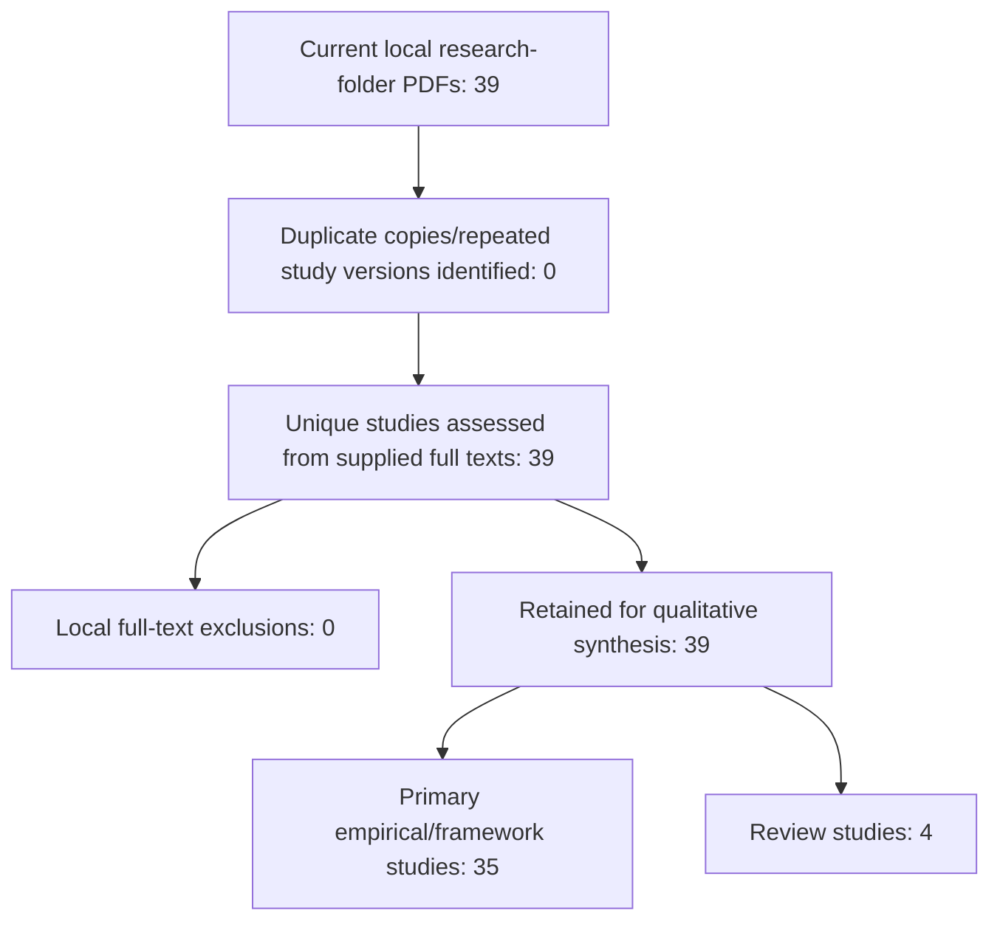

# II. REVIEW PROTOCOL AND METHODOLOGY

This structured literature review examines the evidence supporting GridMind's five capabilities: missing-telemetry reconstruction, demand and renewable forecasting, event diagnosis, cascade-risk prediction, and corrective-action recommendation. Project-wide studies provide an additional integration perspective. Evidence is synthesized against the five research questions stated in Section I: existing research, methods, tools, gaps, and proposed directions. This section retrospectively documents the team's reported search and selection procedure and a subsequent audit of the supplied PDFs. It does not claim a prospectively registered protocol or an independently reproducible systematic database search.

This revised version was checked on 5 November 2026 against the PDFs currently inside `research papers/` and its subfolders; those files are the source of truth for the study set, counts and selection diagram. No supplementary searches or outside studies were added. The team-provided history is preserved in [search_history.csv](reports/literature_review/search_history.csv); file identities, evidence locations, study classifications, assessment status, and unresolved records are recorded in [study_ledger_v2.csv](reports/literature_review/study_ledger_v2.csv). Historical search counts and newly verified local-file counts are different evidence sources and are reported separately.

## A. Eligibility Criteria

The reported searches targeted power-system research relevant to at least one GridMind function or to integrated decision support. Publication-type filters included research articles, articles, and, in some queries, conference papers. Most specified year filters were 2021–2026; the reconstruction and corrective-action rows specified 2021–2027. The 2027 upper bound is preserved as a historical filter setting, not evidence that future publications were reviewed. The forecasting and measurement-anomaly rows supplied filtered counts without a publication-year range. Subject and discipline restrictions differed by query; no uniform filter is retrospectively imposed. The team also reported open-access filtering, but full-text availability in the current collection does not independently establish each source's license.

For the local audit, a study is retained for extraction when its PDF provides assessable research on a GridMind task, a relevant benchmark or evaluation method, or project-wide integration. Review articles are classified separately from primary empirical studies. Task-adjacent work, such as distribution-state estimation, is retained with its boundary stated rather than treated as a direct reproduction target. Older or otherwise unmatched sources remain visible as eligibility exceptions or unresolved historical mappings. Language is recorded from the English-language text available in the PDFs; an original language filter is not documented.

Exact duplicate files and repeated versions of the same study are mapped to one study identity, preserving all source paths. A file is not discarded because its filename is generic or because a complete historical retrieval trail is unavailable. Preprints are identified from the supplied version; their presence is not used to invent a historical preprint-eligibility rule. Sources cited only in other papers' bibliographies are not added to the study set. No quality-score exclusion threshold is retrospectively applied.

## B. Search Strategy

The team supplied nine search rows. The expressions below preserve their reported wording after removing personal initials and source labels as requested. In particular, Q07's Boolean expression has not been silently parenthesized. Database names and execution dates are not consistently recorded in this account, so the original searches cannot be reproduced exactly from these records alone. The audit date is not presented as the original search date.

| Search ID / track | Expression as reported |
|---|---|
| Q01 / cascade risk | `Cascading failure prediction in power systems using machine learning` |
| Q02 / reconstruction | `("power system" OR "power grid") AND ("missing measurements" OR "measurement reconstruction" OR "data imputation")` |
| Q03 / diagnosis | `Power system event classification and fault localization using machine learning` |
| Q04 / cascade risk | `"cascading failures" AND "transmission lines"` |
| Q05 / forecasting | `(wind AND (solar OR photovoltaic) AND (load OR demand)) AND ("net load" OR "short-term forecasting")` |
| Q06 / integration | `"smart grid" AND "decision support system" AND "artificial intelligence"` |
| Q07 / corrective action | `Power System OR Power Grid AND Corrective Action OR Corrective Control AND Artificial Intelligence` |
| Q08 / integration | `"power grid" AND "digital twin" AND "decision making"` |
| Q09 / diagnosis | `"synchrophasor" AND ("bad data" OR "measurement anomalies" OR "clock errors") AND ("grid events" OR "disturbance")` |

| Search | Initial | After date | After type | After subject | After discipline | After open-access filter | Final search count | Reported title/abstract stage | Final choices |
|---|---:|---:|---:|---:|---:|---:|---:|---:|---:|
| Q01 | 1815 | 907 | 780 | No filter | No filter | 363 | 363 | 20 | 3 |
| Q02 | 1156 | 950 | 752 | 596 | 492 | 204 | 204 | 53 | 8 |
| Q03 | 2004 | 1493 | 1013 | 210 | No filter | 153 | 153 | 49 | 12 |
| Q04 | 556 | 300 | 159 | No filter | No filter | 83 | 83 | 10 | 2 |
| Q05 | 2181 | 1535 | 1236 | 1236; no subject filter | 791 | 163 | 163 | 54 | 7 |
| Q06 | 893 | 886 | 400 | No filter | No filter | 171 | 171 | 10 | 3 |
| Q07 | 7901 | 7594 | 4307 | Not recorded | Not recorded | 2068 | 577 | 11 | 6 |
| Q08 | 1899 | 1856 | 861 | No filter | No filter | 385 | 385 | 25 | 2 |
| Q09 | 114 | 86 | 55 | No filter | No filter | 34 | 34 | 34 | 4 |

Q01 uses the team's corrected order, 907 after date filtering and 780 after type filtering. Q02's final shortlist is **8**, superseding the earlier 14→7 and 7 entries. Q07's final choice count is **6**. Its reduction from 2068 after open-access filtering to 577 final search records has no documented intervening operation. The title/abstract-stage column is retained as supplied; it is not assumed to identify all records screened or all records retained. Detailed filter labels and missing fields are preserved in the search-history CSV.

## C. Study Selection Process

The team reports using title/abstract screening followed by final paper selection. The supplied records do not contain individual historical exclusion decisions or a complete mapping from searches to filenames. The present audit therefore inventories the delivered collection, extracts bibliographic identities, compares DOI/title/version and file hashes for duplication, and records relevance from the full texts. It is a documentary review, not evidence of independent dual human screening or supervisor adjudication.

The nine historical final-choice values sum to **47 selection occurrences**. This is not a deduplicated study total: Q01/Q04 and Q03/Q09 can overlap, and query-level choices are not linked to individual delivered papers. The current folders contain **39 PDFs**: cascade risk 3, corrective action 6, diagnosis 10, forecasting 7, reconstruction 8, and Whole Project 5. Agreement between an individual folder count and a query count does not establish a paper-by-paper match. The historical diagnosis rows report 12 and 4 choices, while the diagnosis folder contains 10 files; the historical cascade rows report 3 and 2 choices, while that folder contains 3 files. Missing papers, overlap, and reassignment cannot be distinguished from counts alone.

The local identity audit found **39 distinct study records**, with **0 exact duplicate files** and **0 repeated primary-DOI/title study groups**. All 39 are retained for qualitative synthesis: 35 primary empirical/framework studies and 4 review studies. No local full-text exclusion was imposed. This is an audit disposition, not a reconstruction of the original screening decisions. The eight missing-telemetry PDFs are eight distinct studies. S25 has unresolved manuscript provenance/year, and S37 has an unresolved publication year in its in-press PDF; both remain visible rather than being silently dropped. No verified printed publication year falls outside 2021–2026, although that does not independently prove compliance with every original query filter.

The following PRISMA-style diagram counts only the verified current PDF collection, with duplicate copies counted once. The earlier **47 selection occurrences** remain a separate historical record and are not used as the starting count or as evidence of eight duplicate removals. This is not a reconstructed database-search flow; unique historical retrievals and exclusions remain unavailable.

## D. Quality Assessment

The university guide's five criteria are used for documentary appraisal. Each receives **Yes=1, Partial=0.5, No=0** only when the supporting text can be assessed; unavailable evidence is marked **not assessed**, not automatically scored zero. A mean is reported only for a complete five-item assessment. No score is used to infer that the team historically excluded a paper.

| Criterion | Documentary question | Evidence expected |
|---|---|---|
| Objective clarity | Is the task or review objective explicit? | Abstract/introduction and defined target. |
| Method suitability | Is the proposed method explained and matched to the task? | Method description; for reviews, a search/synthesis approach. |
| Evaluation transparency | Are the data/evidence, experimental conditions, baselines, and metrics reported sufficiently to interpret results? | Experiment/protocol tables; for reviews, source selection and synthesis procedure. |
| Reproducibility | Is enough information or accessible material provided to reconstruct the procedure? | Data/code availability, preprocessing, model settings, and splits; availability on request or confidential data qualifies the assessment. |
| Valid conclusions | Are the conclusions bounded by the reported evaluation and limitations? | Results, discussion, and explicit limits on transfer/deployment claims. |

Appraisal performed for this draft is labeled **provisional documentary assessment** in the ledger and is not represented as independent expert validation. Evidence passages and unresolved issues accompany the scores. Review papers and empirical papers are assessed against their own tasks; a review is not penalized for lacking model-training splits. Team confirmation of the assessments remains outstanding. No aggregate quality ranking across incompatible tasks is used to select GridMind's models.

**Summary of recorded assessments.** The checked ledger records Yes scores for objective clarity and method suitability in all 39 studies. Reproducibility was the most frequent qualification, receiving Partial scores in 31/39 studies (79.49%), compared with 7/39 for evaluation transparency and 10/39 for the support and scope of conclusions. Mean recorded scores ranged from 0.70 to 1.00; these remain provisional documentary ratings rather than independent validation of the methods, and no study was excluded on that basis.

## E. Data Extraction and Synthesis

The extraction unit is the unique research study, while the inventory unit is the supplied PDF. The ledger preserves both identities, source paths, hashes, title, authors, year, venue, DOI/preprint identifier, publication-version status, study type, method family, capability tags, RQ relevance, and historical-mapping status. It also records task, readings/features consumed and predicted, dataset/network, horizon or observation window where available, split/baselines/metrics, bounded findings, limitations, and PDF page locations.

Method-specific evidence is extracted rather than forced into one metric. Reconstruction records distinguish observed versus recovered channels, missingness patterns, future-reading requirements, equipment status, topology assumptions, and downstream tests. Forecasting records distinguish targets, horizons, chronological availability, weather/capacity features, and persistence baselines. Diagnosis records distinguish event type, physical location, measurement error, and episode-level evaluation. Cascade records distinguish initiating-outage assumptions, propagation/consequence targets, and simulator conditions. Corrective-action records distinguish the action space, candidate validation, and simulated operational outcomes from classification accuracy.

Synthesis first compares studies within a capability, then uses their shared patterns and differences to answer RQ1–RQ5. Numerical findings retain their units and experimental context; errors from different datasets are not pooled or ranked as if they came from a common benchmark. Missing details are labeled unreported or unverified. Paper-reported findings, our cross-paper interpretation, and GridMind's proposed adaptation remain distinguishable. Cross-cutting papers inform architecture and decision support without being counted as five separate studies.

## F. Data Extraction Table — Table I

Table I gives a compact overview of the extraction coverage. The complete one-row-per-study extraction, including titles/DOIs, methods, datasets, metrics, findings, limitations and evidence pages, is retained in [Appendix A, Table I continued](GridMind_Section_II_Appendix_A_Study_Extraction_v2.md#table-i-continued--full-study-extraction) and the [versioned study ledger](reports/literature_review/study_ledger_v2.csv). Study IDs are unchanged and are not replacements for Section I citation numbers.

| Research track / filing group | Unique studies | Study IDs | Main extraction focus |
|---|---:|---|---|
| Cascade risk | 3 | S01, S02, S03 | Initiating conditions, line criticality, propagation and consequence evidence. |
| Corrective action | 6 | S04, S05, S06, S07, S08, S09 | Action space, constraints, simulator checks, cost and runtime. |
| Event diagnosis | 10 | S10, S11, S12, S13, S14, S15, S16, S17, S18, S19 | Measured signals, event labels, classification/localization and validation units. |
| Forecasting | 7 | S20, S21, S22, S23, S24, S25, S26 | Demand/renewable targets, horizon, available inputs, baselines and forecast errors. |
| Missing telemetry | 8 | S27, S28, S29, S30, S31, S32, S33, S34 | Observed/recovered channels, temporal availability, topology and downstream tests. |
| Project-wide integration | 5 | S35, S36, S37, S38, S39 | Integrated workflows, decision-level evaluation and cross-module limitations. |

The six groups account for all **39 unique studies**, including **8 missing-telemetry studies**; each study appears once in this overview. Capability tags in Table III may overlap. Full bibliographic identities and publication-status uncertainties remain in Appendix A and the ledger.

*Layout note:* The university guide requires one row per selected paper. Those rows are preserved in full in Appendix A; the guide does not explicitly confirm whether appendix placement is accepted, so this compact-body layout remains subject to the university's final formatting requirements.

## G. Methodology Summary — Table II

| Review step | Purpose | What was done and its status |
|---|---|---|
| Scope | Align evidence with the project and RQs. | Five capabilities plus integration; supplied-PDF-only audit completed. |
| Historical search record | Preserve the team's procedure. | Nine rows transcribed with explicit corrections; database/date mapping omitted; original execution not independently reproduced. |
| Eligibility | Describe selection boundaries. | Historical filters reported per query; current corpus exceptions separately flagged rather than silently removed. |
| Inventory and duplication | Establish a verifiable denominator. | All PDF paths, hashes, and bibliographic identities recorded; study/version grouping documented in the ledger. |
| Selection reconciliation | Separate records, files, and studies. | Historical 47 choice occurrences distinguished from 39 delivered PDFs; query-to-file mapping unresolved. |
| Quality appraisal | Qualify the strength and reporting of evidence. | Provisional documentary assessment recorded with supporting pages; no retrospective cutoff or independent reviewer agreement claimed. |
| Extraction | Make comparisons traceable. | Extraction coverage summarized in compact Table I; all 39 study rows retained in Appendix A and the versioned ledger. |
| Synthesis | Answer the RQs through comparison. | Narrative/thematic approach specified; detailed RQ answers belong in Section III. |
| Descriptive reporting | Describe the actual review collection. | Table III derived from unique study records; overlapping tags and unknown fields explicitly identified. |

## H. Descriptive Statistics — Table III

Table III uses **N = 39 unique studies** as its denominator. Folder membership is a mutually exclusive filing category, not proof of a study's historical search source. Capability tags overlap; their percentages may sum above 100%. Method family is an audit-assigned primary family for descriptive grouping, not a claim that a hybrid paper uses only one technique. Printed issue years are used where present; DOI/copyright/acceptance years are not substituted for an unresolved publication year.

| Attribute | Category | Count | % of 39 |
|---|---|---:|---:|
| Publication year | 2021 | 2 | 5.13% |
| Publication year | 2022 | 1 | 2.56% |
| Publication year | 2023 | 5 | 12.82% |
| Publication year | 2024 | 5 | 12.82% |
| Publication year | 2025 | 7 | 17.95% |
| Publication year | 2026 | 17 | 43.59% |
| Publication year | Not verified from PDF | 2 | 5.13% |
| Study type | Empirical | 33 | 84.62% |
| Study type | Empirical/framework | 2 | 5.13% |
| Study type | Review | 4 | 10.26% |
| Venue as printed | Applied Energy | 7 | 17.95% |
| Venue as printed | Discover Electronics | 1 | 2.56% |
| Venue as printed | EAI Endorsed Transactions on Energy Web | 1 | 2.56% |
| Venue as printed | Electric Power Systems Research | 3 | 7.69% |
| Venue as printed | Energy | 1 | 2.56% |
| Venue as printed | Energy Engineering | 1 | 2.56% |
| Venue as printed | Energy Informatics | 2 | 5.13% |
| Venue as printed | Energy Reports | 2 | 5.13% |
| Venue as printed | Energy and AI | 4 | 10.26% |
| Venue as printed | Engineering (in press; unpaginated issue) | 1 | 2.56% |
| Venue as printed | Industrial Artificial Intelligence | 1 | 2.56% |
| Venue as printed | International Journal of Electrical Power & Energy Systems | 6 | 15.38% |
| Venue as printed | Nature Communications | 2 | 5.13% |
| Venue as printed | Not stated in PDF | 1 | 2.56% |
| Venue as printed | Results in Engineering | 1 | 2.56% |
| Venue as printed | SN Applied Sciences | 1 | 2.56% |
| Venue as printed | Sustainable Energy, Grids and Networks | 2 | 5.13% |
| Venue as printed | The Journal of Engineering | 1 | 2.56% |
| Venue as printed | e-Prime - Nexus of Electrical, Electronic, and Intelligent Engineering | 1 | 2.56% |
| Source folder | Cascading Risk Prediction | 3 | 7.69% |
| Source folder | Corrective Action Recommendation | 6 | 15.38% |
| Source folder | Event Diagnosis | 10 | 25.64% |
| Source folder | Forecasting | 7 | 17.95% |
| Source folder | Missing Telemetry Reconstruction | 8 | 20.51% |
| Source folder | Whole Project | 5 | 12.82% |
| Capability tag (overlapping) | Cascade risk | 5 | 12.82% |
| Capability tag (overlapping) | Corrective action | 10 | 25.64% |
| Capability tag (overlapping) | Event diagnosis | 15 | 38.46% |
| Capability tag (overlapping) | Forecasting | 9 | 23.08% |
| Capability tag (overlapping) | Integration | 12 | 30.77% |
| Capability tag (overlapping) | Missing telemetry | 12 | 30.77% |
| Primary method family | Graph index/optimization | 4 | 10.26% |
| Primary method family | Graph learning | 7 | 17.95% |
| Primary method family | Physical/statistical simulation | 2 | 5.13% |
| Primary method family | Review synthesis | 4 | 10.26% |
| Primary method family | Statistical/ML | 11 | 28.21% |
| Primary method family | Temporal/deep learning | 11 | 28.21% |

Publication-format summary: **37 journal-formatted published articles (94.87%)**, **1 in-press journal article with unresolved publication year (2.56%)**, and **1 manuscript with unresolved venue/year/version (2.56%)**. These are PDF-format classifications, not independent peer-review verification. No separate conference-format PDF was identified; a journal article associated with a conference remains classified by its supplied journal format.

Quality scores are provisional assessment records, not measured model performance or a final eligibility ranking. All 39 records contain five documentary scores; no study was excluded on that basis. The ledger preserves the rationale and relevant pages.

Study IDs are listed in compact Table I; full citation identities, evidence pages and source paths are retained in Appendix A and the versioned ledger. Some bibliographic author lists are shortened with “et al.”; the original printed author header is authoritative. No later publication lookup or new source was used.

The statistics describe the supplied, audited collection, not all literature returned by the original searches. Historical open-access filters, incomplete retrieval metadata, inclusion of task-adjacent studies, and unresolved query-to-file mapping limit search reproducibility and generalization. A PDF version's publication label is not independent verification of its review process. These review limitations belong in Section V's validity discussion; they do not establish shortcomings in the Egyptian grid or prove that GridMind's planned methods outperform the reviewed studies.
