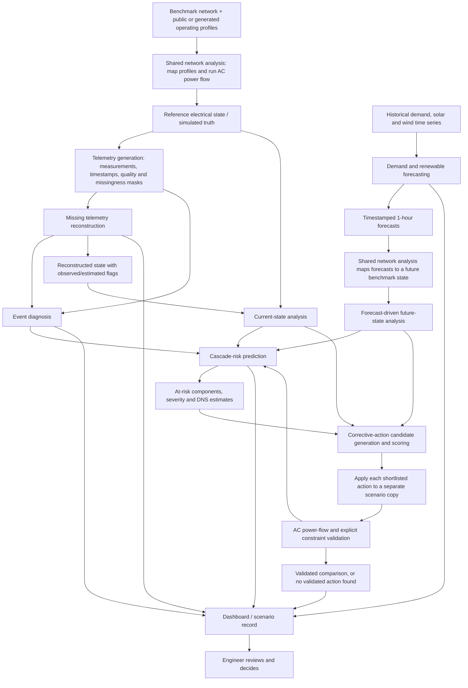

# GridMind: Whole-System Project and Model Pipeline

**Document purpose:** Integrated project overview combining the five model specifications currently in the workspace.  
**System type:** Software-only, topology-aware, human-in-the-loop decision-support prototype.  
**System boundary:** Benchmark/simulated power networks and public datasets; no connection to the Egyptian national grid, confidential SCADA, or live equipment control.

> **Status and attribution:** The five model documents describe planned modules, research-grounded choices, and open design decisions. They do not establish that all models have been trained, integrated, or validated. “Proposed integration” below means an interface and flow suggested by the documents, not an already implemented system behavior. Published paper results are not GridMind results.

## 1. Project Idea

GridMind is a prototype decision-support platform for grid engineers. It combines five AI functions that address different questions about a simulated power network:

1. **Missing Telemetry Reconstruction:** What values may be missing from measurements when the equipment itself remains in service?
2. **Demand and Renewable Forecasting:** What demand, solar generation, and wind generation are expected one hour ahead?
3. **Event Diagnosis:** Is an abnormal measurement pattern more consistent with a sensor problem or a physical grid event, and where is the physical event likely located?
4. **Cascade-Risk Prediction:** Given a grid state and an initiating outage, which components could fail next and what consequences could follow?
5. **Corrective-Action Recommendation:** Which available interventions may improve a stressed state, and which pass explicit simulator checks?

The models work with a shared simulated network context, but they do not all consume one another's outputs. Shared network analysis prepares grid states and verifies electrical consequences. AI predictions and recommendations are shown with their inputs, assumptions, provenance, and uncertainty so an engineer can review the evidence and make the decision.

## 2. System Boundary and Shared Concepts

### 2.1 Simulated network and operating data

The prototype uses a benchmark grid model with buses, lines, transformers, generators, loads, equipment limits, and topology. Public or generated operating profiles are mapped onto the benchmark using declared scaling and allocation assumptions. `pandapower` is proposed for AC power-flow analysis and candidate-action validation. A converged power flow is not, by itself, proof that every operating constraint is satisfied or that the system is safe.

For the main event-driven demonstration, an AC power-flow solution can be used to create a reference electrical state. A telemetry layer then creates SCADA-like observations, including selected missing readings, measurement quality conditions, and timestamps. This makes it possible to compare reconstruction with known simulated truth. Public time series used by the forecasting model remain in their source domain until a documented transformation maps them to the simulated network; aggregate ERCOT MW values must not be passed directly into a smaller benchmark as though they were measured there.

### 2.2 Shared data and interface rules

Every module exchange should preserve:

- `scenario_id`, network/topology version, and relevant component IDs;
- issue, observation, target, and simulation timestamps with a declared time basis;
- consistent units (for example, MW, MVAr, pu, degrees, and percent of rating);
- the source and status of every value: observed, reconstructed, forecast, simulated, unavailable, or derived;
- model name/version, scenario assumptions, and uncertainty or abstention status where applicable.

Measured and reconstructed values remain distinguishable. A missing measurement is not evidence of a physical outage, and reconstruction must never mark an out-of-service component as healthy.

## 3. Whole-System Pipeline



The diagram is a proposed logical flow. Model execution may be conditional: for example, event diagnosis requires an abnormal window or a normal class, and cascade-risk prediction requires a defined initiating outage for reactive screening. Corrective-action suggestions are always conditional on the state, available controls, and validation assumptions.

### 3.1 Runtime stages

1. **Prepare a scenario.** Load the benchmark topology, equipment status, operating limits, and a selected time-profile or contingency. Run the shared AC power-flow process and preserve convergence and constraint status.
2. **Create or receive telemetry.** Align measured/simulated readings by time and component. Preserve missingness, measurement-quality, and in-service masks separately.
3. **Reconstruct only eligible missing readings.** Estimate unavailable measurements only where the associated equipment is still in service and status is sufficiently known. Preserve both original observations and flagged estimates.
4. **Forecast future aggregate power in parallel.** Use historical hourly demand, solar, and wind series to produce the one-hour-ahead forecasts. Shared network analysis maps these forecasts into a future benchmark scenario under explicit assumptions; the forecasting model itself does not predict line loading.
5. **Diagnose abnormal measurement windows.** Use original observations, available flagged reconstructed values, timestamps, component IDs, and any agreed network context. Classify sensor problem versus physical event; localize only physical events when labels support that task. Return uncertain when evidence is inadequate.
6. **Estimate cascade consequences.** For a current, hypothetical, or forecast-derived electrical state plus an explicit initiating outage, estimate downstream line/bus failures, severity, and demand not served (DNS). These are conditional consequence estimates, not the probability that the initiating outage will occur.
7. **Generate corrective candidates.** Produce legal actions supported by the current prototype, initially generator redispatch, renewable curtailment, and no-change. Rank candidates using a baseline or proposed learned scorer.
8. **Validate candidates physically.** Apply each shortlisted candidate to a separate copy of the scenario and run AC power flow and configured checks for convergence, line/transformer loading, bus voltages, resource limits, external-grid/slack limits, and connectivity/supply.
9. **Present evidence.** Show forecasts, diagnosis, cascade-risk estimates, action changes, validation outcomes, data provenance, and assumptions. The engineer chooses what to do; GridMind does not operate equipment.

### 3.2 Offline model-development pipeline

The offline pipeline is distinct from runtime inference:

1. Select benchmark networks, public profiles, paper datasets, and licenses/usage conditions.
2. Generate or verify reference states with the appropriate simulator or released data.
3. Create model-specific labels and masks. For example, hide known telemetry values for reconstruction; use chronological target splits for forecasting; keep event episodes together for diagnosis; simulate initiating outages and cascade progression for cascade labels; and evaluate candidate actions against explicit constraints for corrective-action labels.
4. Split by time, scenario, episode, or network as appropriate **before** making overlapping windows, variants, or candidate rows, to prevent leakage.
5. Train and compare each model against task-appropriate baselines. Use independent test data and document seed, preprocessing, model version, and metrics.
6. Save weights, fitted preprocessors, input schema, output schema, and model card/version metadata.
7. Evaluate integrated handoffs separately from each model's isolated performance (for example, diagnosis with reconstructed inputs or cascade assessment after validated actions).

## 4. Model 1 — Missing Telemetry Reconstruction

### Purpose and proposed model

Estimate unavailable electrical measurements for equipment that remains in service. The current recommended design is a shared missingness-aware, edge-conditioned GNN with a causal GRU, separate line and bus output heads, and physics/quality checks after prediction.

### Inputs

- Recent node and edge measurement history, with timestamps and known units.
- Bus-line topology, active-edge set, and component indexing.
- Electrical line attributes such as resistance/reactance and other supported static properties.
- Separate measurement-missingness, edge-validity/equipment-status, and optional measurement-quality masks.
- Available operating context and historical window (causal: current and past only).

### Outputs

- **Line head:** estimated active and reactive power at both ends of each line (`P_from`, `Q_from`, `P_to`, `Q_to`) for target missing/required values.
- **Bus head:** estimated voltage magnitude; voltage angle is secondary and requires reference-angle alignment.
- Per-value status/provenance (observed, reconstructed, uncertain/unavailable), quality information, and model metadata.
- Derived current/loading only where coherent electrical quantities and known ratings permit; these are derived values, not independent initial prediction heads.

### Connections

- Receives simulated/observed telemetry from shared network analysis and telemetry generation.
- Passes flagged estimates to event diagnosis and the current state used by cascade screening; optionally to forecasting only under a separately defined and evaluated history-input policy.
- Must preserve original observations and never convert missing data into physical equipment status.

## 5. Model 2 — Demand and Renewable Forecasting

### Purpose and proposed model

Forecast aggregate electricity demand, solar generation, and wind generation one hourly step ahead. The leading configuration is three separately trained predictors using the indirect approach, with indirect LSTM compared against indirect FCNN and persistence references. Final model selection depends on GridMind evaluation.

### Inputs

- Validated hourly historical demand, solar, and wind series, with source/control-area identifier and target timestamps.
- Target-specific historical lags and windows, including relevant 1-, 2-, 24-, and 48-hour histories as defined in the model document.
- Calendar features and renewable capacities known at forecast issue time.
- The released solar proxy where used by the reference pipeline. Weather is an optional extension, not required in the initial setup.
- Any reconstructed input must remain explicitly flagged and its use evaluated separately.

The initial forecasting networks do not take electrical topology as an input.

### Outputs

- Demand, solar, and wind point forecasts in MW for the target hour.
- Derived net load: `demand_mw - solar_mw - wind_mw`.
- Forecast record with issue time, target time, horizon, region, model version, and input/data-quality status.

### Connections

- Runs from historical source-domain time series, alongside the telemetry pipeline.
- Sends forecasts to the dashboard and to shared network analysis, which maps aggregate profiles to the benchmark network using declared allocation/scaling assumptions and runs the electrical calculation.
- Supplies a future operating state to cascade-risk screening and corrective-action candidate analysis only after that transformation. Forecast values alone are not line overloads or component-risk predictions.

## 6. Model 3 — Event Diagnosis

### Purpose and proposed model

For an abnormal measurement window, distinguish a sensor problem from a physical grid event. If it is classified as physical, estimate the likely affected bus or line when matching location labels are available. The design proposes comparing Random Forest and XGBoost for the first-stage classification and using an LSTM for event localization; choices remain pending evaluation.

### Inputs

- Time-aligned electrical measurement sequence for a defined observation window (channels may include voltage, current, and active/reactive power, subject to data availability).
- Timestamps and component IDs.
- Original observations, retained without replacement.
- Reconstructed values with per-value flags, if available.
- Available topology and equipment status for mapping/context; exact topology use is not finalized.
- A detected abnormal window from an upstream detector, or a normal class if this module is expected to distinguish normal operation too.

### Outputs

- Event category: sensor problem, physical event, or uncertain (subject to the implemented class set).
- Physical-event location as a bus ID or line ID consistent with training labels; otherwise unavailable/uncertain.
- Observation-window timestamps, diagnosis time, data limitations, and reliability/uncertainty information.

### Connections

- Receives telemetry directly and may receive reconstruction estimates with provenance flags.
- Sends physical-event type/location and uncertainty to cascade-risk screening, corrective-action context, and the dashboard.
- Does not predict cascade propagation, choose a corrective action, or locate a faulty sensor in the current scope. A suspicious sensor reading alone must not be passed downstream as a confirmed physical outage.

## 7. Model 4 — Cascade-Risk Prediction

### Purpose and proposed model

Given an electrical state and an initiating contingency, estimate which components could fail next and the conditional consequences. The research-grounded reference is PI-GN-JODE; the GridMind simulator, labels, and implementation still require their own verification. The module is planned, not yet implemented or validated.

### Inputs

- Benchmark topology, bus/node and line/edge features, equipment status, electrical properties, and a consistent graph mapping.
- Current or forecast-derived operating state: power flows/injections, bus voltage, loading, demand/generation, and other defined features.
- Initiating outage/contingency (observed event or explicitly selected what-if outage).
- Provenance flags for measured, reconstructed, simulated, and forecast values.
- Event diagnosis output can inform the initiating event/component, but only after distinguishing physical events from sensor problems.
- Forecast inputs require shared network analysis to transform aggregate forecasts into a coherent future electrical state.

The PI-GN-JODE paper reports eleven node and twelve directed-edge features; the exact GridMind feature mapping and treatment of disconnected branches must be defined. Downstream failure labels are training targets, not inference inputs.

### Outputs

- Per-edge/branch failure scores or probabilities for subsequent cascade steps.
- Per-node/bus failure scores or probabilities, according to defined labels.
- Severity classification and estimated demand not served (DNS).
- Optional propagation-by-round output if the sequence implementation supports it.
- Scenario, model-version, data-provenance, and calibration/uncertainty information.

The scores describe consequences conditional on the supplied operating state and initiating contingency. They do not by themselves give the probability of the initial fault. A dashboard risk tier is a separate aggregation policy and must not be presented as a calibrated probability unless validated.

### Connections

- Receives electrical states from shared network analysis, flagged estimates from reconstruction, event/contingency information from diagnosis or scenario selection, and transformed future states from forecasting.
- Sends vulnerable components, severity, DNS, and assumptions to corrective-action recommendation, dashboard, and scenario history.
- Can rescore states after an action has passed simulator checks. Lower predicted cascade risk does not establish physical feasibility; action validation is separate.

## 8. Model 5 — Corrective-Action Recommendation

### Purpose and proposed model

Help an engineer compare supported interventions for a stressed simulated grid state. The initial action space is generator redispatch, renewable curtailment, and no-change. The first paper is about imitation learning for topology actions; its result is a design reference, not evidence that GridMind redispatch works. The proposed GridMind extension is expert/simulator-generated training data, a baseline scorer, and evaluation of a graph-based GNN/GAT candidate scorer.

### Inputs

- Grid structure and topology: bus IDs, connections, and in-service equipment.
- Credible operating state: voltage, injections, branch loading, generator outputs, and constraint/limit data.
- Available control resources and legal ranges: generator limits/availability/ramping, renewable availability, response interval, and any explicit balancing assumptions.
- Candidate action and affected assets/setpoint changes.
- Optional context from forecasts, event diagnosis, and cascade risk, with uncertainty and scenario provenance.
- A scenario-specific objective/constraints for comparing benefit and intervention amount.

### Outputs

- Ranked candidate actions with affected assets and exact setpoint changes.
- For each validated candidate: post-action loading and voltage, constraint-check results, remaining violations, intervention amount, optional cost, scenario/topology/version, and validation scope.
- Explicit failure/abstention result if no candidate in the evaluated set passes; this does not prove that no feasible action exists.

### Connections

- Receives current or forecast-derived stressed states from shared network analysis; may use cascade-risk outputs to prioritize expected impact and diagnosis to clarify the initiating event.
- Generates legal candidates and ranks them. The first prototype may perform candidate generation and simulation before adding the learned scorer.
- Sends shortlisted candidates to shared AC power-flow validation. Validated results return to the dashboard and may be used to create labeled training records or rescore cascade consequences.
- Never treats a learned score as proof that an action is safe. Only simulator checks within the stated modeled constraints can qualify the candidate for display as validated.

## 9. Shared Network Analysis and Validation (Non-AI)

This is an enabling software process, not a sixth AI model. It:

1. Loads the benchmark network and assigns stable bus/line/transformer IDs.
2. Maps declared load and generation profiles into the network.
3. Runs AC power flow to create or update a simulated electrical state.
4. Checks convergence, line/transformer ratings, bus-voltage bounds, generator and external-grid/slack limits, and connectivity/supply as configured.
5. Applies each candidate action to a separate scenario copy and reruns the checks.
6. Returns state values, validation status, violations, and failure reasons to the relevant modules.

Simulation validity is a separate research requirement. `pandapower` provides network modeling and power-flow capabilities; it does not automatically constitute a validated cascading-failure simulator. Cascade progression, protection rules, island handling, and DNS labeling require explicit implementation and checks.

## 10. Whole-System Inputs and Outputs

| System stage | Main inputs | Main outputs | Consumers |
|---|---|---|---|
| Scenario/network preparation | Benchmark topology, equipment properties/limits, public or generated profiles | Solved or unresolved scenario state, topology/version IDs | Telemetry, forecasting integration, cascade, action model |
| Telemetry generation / ingestion | Simulated or available measurements, timestamps, component IDs, status | Observations, missingness/quality/status masks | Reconstruction, diagnosis |
| Missing telemetry reconstruction | Recent node/edge history, topology, masks, status | Reconstructed line P/Q and bus voltage estimates with provenance/quality | Diagnosis, current-state analysis, optionally forecasting under evaluated policy |
| Demand/renewable forecast | Historical demand/solar/wind, calendar/capacity features | One-hour demand/solar/wind and net load forecast record | Shared network analysis, dashboard |
| Event diagnosis | Measurement sequence, original and flagged reconstructed readings, event-window context | Category, physical location if applicable, uncertainty | Cascade risk, corrective action, dashboard |
| Cascade risk | Electrical state, topology, initiating contingency, optional transformed forecast state | Component-level failure scores, severity, DNS, uncertainty | Corrective action, dashboard, scenario record |
| Corrective action | Stressed state, limits/resources, candidate controls, optional forecast/risk context | Ranked actions and abstention/result metadata | Shared network validation |
| Shared validation | Scenario copy and action candidate | AC solution, constraint results, violation/convergence status | Corrective-action ranker, cascade rescoring, dashboard |
| Dashboard/scenario record | All versioned model and validation outputs | Evidence for human comparison and decision | Engineer/operator |

## 11. Example End-to-End Use Case

1. A benchmark network and operating profile are loaded. Shared network analysis runs AC power flow and creates a reference state.
2. The telemetry layer produces timestamped measurements and marks a subset missing while retaining equipment status and reference values for evaluation.
3. Reconstruction estimates eligible missing values and returns estimate flags. The true equipment status remains a separate field.
4. If the window is abnormal, event diagnosis uses original and flagged reconstructed readings. It reports sensor problem, a likely physical event/location, or uncertainty.
5. In parallel, the forecasting service produces next-hour demand, solar, and wind. Shared network analysis maps those aggregate forecasts into a future scenario and runs power flow under declared assumptions.
6. For a confirmed or hypothetical initiating outage, cascade risk estimates subsequent at-risk components, severity, and DNS for the selected current or future state.
7. Corrective-action logic generates supported redispatch/curtailment candidates, ranks them, and passes a shortlist to AC validation.
8. The dashboard compares the diagnosis, forecasts, cascade consequences, candidate actions, and validation evidence. The engineer decides whether to use a recommendation.

All values in this sequence are scenario-specific. A model score, simulated result, reconstructed value, or forecast must be labeled as such and not presented as an observed fact.

## 12. Integration Contracts and Open Decisions

### 12.1 Proposed common record envelope

The following is a conceptual envelope, not a finalized API:

```json
{
  "scenario_id": "scenario-identifier",
  "network_id": "benchmark-network",
  "topology_version": "topology-version",
  "issued_at": "timestamp-with-timezone",
  "valid_time": "timestamp-with-timezone",
  "source_status": "observed|reconstructed|forecast|simulated|derived|unavailable",
  "model_name": "module-name",
  "model_version": "version",
  "payload": {},
  "uncertainty_status": "available|uncertain|abstained"
}
```

Each model needs its own validated payload schema with units, component indexing, tensor/sequence shape, masks, and target definitions. This common envelope does not replace those model-specific contracts.

### 12.2 Decisions still to finalize

- The benchmark network(s), operating profiles, profile-to-network mapping, and capacity/scaling assumptions.
- The telemetry sampling cadence, measurement channels, missingness and quality masks, and shared component ordering.
- The exact event-diagnosis dataset, supported event/location labels, normal-operation detector/class, and use of topology.
- The cascade simulator/protection rules, islands and DNS treatment, graph indexing, probability calibration, and risk display thresholds.
- The action generator, candidate limits, balancing model, response interval, cost objective, fallback budget, and supported controls beyond the initial scope.
- The versioned inter-module API, persistence schema, and owner of shared network-analysis/validation code.
- Model-specific uncertainty and abstention rules, plus end-to-end acceptance criteria.

Until these are settled, the interfaces and cross-model connections in this document should be read as an integration proposal based on the five model specifications.

## 13. Source Model Documents

- [Missing Telemetry Reconstruction](GridMind_Missing_Telemetry_Complete_Research_and_Model.md)
- [Demand and Renewable Forecasting](GridMind_Demand_Renewable_Forecasting.md)
- [Event Diagnosis](EVENT_DIAGNOSIS.md)
- [Cascade Risk Prediction](GridMind_Cascade_Risk_Prediction_Model.md)
- [Corrective-Action Recommendation](GridMind_Corrective_Action_Model.md)
